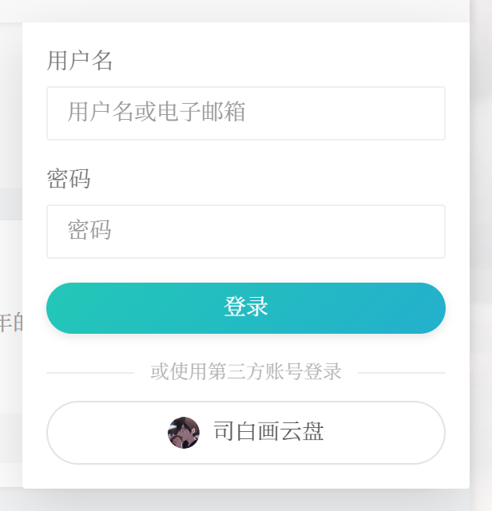

# OAuthLogin —— Typecho 第三方账号登录

为 Typecho 博客接入第三方账号登录。后台登录页的按钮沿用 `.typecho-login` 卡片与 `.btn` 规格；
网站前台则把按钮嵌进主题自带的登录弹窗（右上角钥匙图标展开的那个），排在用户名密码表单下方。




## 安装

```bash
# 方式一：clone 到插件目录（目录名必须是 OAuthLogin）
cd usr/plugins && git clone https://github.com/sibaihua/OAuthLogin.git OAuthLogin
```

方式二：下载 Release 里的 `OAuthLogin-x.y.z.zip`，解压后把 `OAuthLogin` 整个目录放进 `usr/plugins/`。

然后：

1. 后台「控制台 → 插件」启用 OAuthLogin（启用时会自动建表 `typecho_oauth_accounts`）。
2. 「设置」里填客户端凭据，「回调地址」可以留空（按访客当前域名自动生成 `https://当前域名/`）。
3. 到第三方平台登记同一个回调地址，一字不差（含结尾斜杠）；站点有多个域名就逐个登记。
4. 退出登录，回到登录页确认按钮出现。

环境要求：Typecho 1.2+、PHP 7.4+（已在 PHP 8.4 上运行）、`curl` 扩展、MySQL 5.7+。

## 支持的登录方式

| 方式 | 协议 | 说明 |
| --- | --- | --- |
| OpenID Connect | OIDC | 通用实现，自动读取 `/.well-known/openid-configuration`；默认对接 Cloudreve（`pan.sibh.cn`） |
| QQ 互联 | OAuth 2.0 | `graph.qq.com`，scope `get_user_info` |
| GitHub | OAuth 2.0 | `github.com/login/oauth` + `api.github.com/user` |
| Gitee | OAuth 2.0 | `gitee.com/oauth` + `api/v5/user` |

## 文件结构

```
OAuthLogin/
├── Plugin.php              插件入口：启用/停用、配置表单、三个钩子
├── Lib/
│   ├── Settings.php        配置读写与默认值
│   ├── Handler.php         登录发起、回调处理、登录页资源注入
│   ├── Auth.php            账号关联/自动注册/登录态写入
│   ├── Profile.php         后台个人设置里的绑定/解绑面板
│   ├── Url.php             访问域名识别（多域名站点跟随当前域名）
│   ├── Store.php           绑定表 oauth_accounts 的读写
│   ├── Http.php            curl 封装
│   └── ProviderFactory.php 提供方工厂
├── Provider/
│   ├── AbstractProvider.php
│   ├── Oidc.php
│   ├── Qq.php
│   ├── Github.php
│   └── Gitee.php
└── assets/
    ├── login.css
    └── login.js
```

## 工作方式

1. 后台登录页 `/admin/login.php` 通过 `admin/header.php:header` 钩子注入 CSS/JS，
   由 JS 把「或使用第三方账号登录」板块挂到登录表单与「返回首页」之间。
2. 网站前台则在 `index.php:begin` 开启输出缓冲，页面渲染完成后把第三方登录按钮
   插入主题登录弹窗（`#login_container` 内、用户名密码表单的下方），已登录访客不注入。
3. 点击按钮访问 `/?oauth=login&provider=xxx`（站内相对地址，跟着当前访问的域名走），
   由 `index.php:begin` 钩子接住，生成 state 写入 Cookie 后 302 到提供方授权页。
   前台按钮的链接会额外带一个 `return` 参数（发起登录时所在页面的 base64url 编码），
   后台登录页发起时则没有。`return` 由一小段内联脚本在**点击那一刻**用 `location.href` 重算——
   主题的登录面板会跨页面复用（PJAX），渲染时算出来的值可能是上一个页面的。
4. 提供方回跳 `redirectUri`（默认 `https://当前域名/`），带 `code` 与 `state`；
   同一钩子校验 state、换取 token、读取用户资料。
5. 依次尝试：已绑定账号 → 邮箱匹配已有账号 → 按配置自动注册。
6. 调用 `Widget\User::commitLogin()` 写入 Typecho 登录态。
7. 跳转：有来源页则回到发起登录的那个页面（文章页就回文章页），
   没有则按角色决定（管理员进后台、其他角色回首页）。
   来源页只接受本站已允许的域名，且会过滤登录页与含 `oauth=` / `code=` 的地址，防止开放重定向。

## 多域名

站点同时用多个域名访问（例如 `blog.sibaihua.com` 与 `blog.sibh.cn`）时，Typecho 的站点地址
只有一个，登录链接很容易把访客带去另一个域名，而登录态是按域名隔离的，于是「授权成功却没登录」。

插件里的处理：

- HTML 里的登录 / 绑定链接一律用站内相对地址（`/?oauth=login...`），浏览器按当前域名解析，
  页面被 CDN 缓存也不会错。
- 服务端回跳、回调地址、后台地址按「本次请求的域名」生成；`设置 → 基本设置` 的站点地址
  仍作为兜底。
- 只跟随**站点地址本身**与「额外允许的域名」里列出的域名，防止 Host 头被伪造后跳到陌生站点。
- 回调地址跟着域名变，所以每个域名的回调地址都要在第三方平台登记一次，
  否则从该域名发起会被平台以 `redirect_uri` 不匹配拒绝。

## 数据库

启用时创建 `typecho_oauth_accounts`（`provider` + `openid` 唯一索引），停用插件不删数据。

## 已有账号绑定 / 解绑

后台「个人设置」页面的「第三方账号」板块（密码修改下方）列出所有已启用的登录方式：

- **未绑定**：点「绑定」，跳转到对应平台授权，回来即完成绑定。绑定要求当前已登录，
  且同一个第三方账号不能同时绑定到两个本站用户。
- **已绑定**：显示昵称 / 邮箱 / 绑定时间，点「解绑」即可解除。
  解绑后只能用本站用户名密码登录，所以按钮会先确认一次。
- 解绑请求带 CSRF 令牌，仅能解除自己的绑定。

绑定与登录共用同一套回调地址，不需要在第三方平台额外登记。

## 注意

- 回调地址必须与第三方平台登记的一字不差。
- `client_secret` 以明文保存在 `typecho_options` 中，请勿把数据库导出文件外传。
- 自动注册的默认用户组建议保持「贡献者」，设为管理员等于对外开放后台权限。

## 更新记录

### 1.5.0
- 修复：站点绑定多个域名时，前台与后台的第三方登录链接固定使用 Typecho 的站点地址，
  从别的域名点击登录会被带到主域名，登录态又按域名隔离，表现为「授权成功仍然未登录」。
  现在登录 / 绑定链接改为站内相对地址，回调地址、回跳地址、后台地址都跟随当前访问域名。
- 新增设置「登录链接跟随当前访问域名」，以及「额外允许的域名」（只跟随站点地址与这里列出的域名，
  防止 Host 头被伪造）。
- `回调地址` 留空时按当前域名自动生成；填了固定地址时只替换域名部分，路径保持不变。

### 1.4.0
- 新增：后台「个人设置」里可以**绑定 / 解绑**第三方账号（已有账号不用等自动注册）。
- 绑定时校验：同一第三方账号不能绑定到多个本站用户，同一本站用户同一平台只保留一个绑定。
- 解绑走表单 POST + CSRF 令牌，并有二次确认。
- 后台板块标题改为「第三方账号登录」，文案统一为「OpenID Connect」，不再带站点专属名称。
- 修复：启用本插件后打开「个人设置」偶发 500（`插件OAuthLogin的配置信息没有找到`），
  现在会自动补上 Typecho 需要的 `_plugin:OAuthLogin` 占位行。

### 1.3.0
- 修复：在文章页点登录、完成后却回到首页。原因是主题的登录面板跨页面复用（PJAX），
  按钮里的 `return` 还是首屏页面的地址；现在改为点击的那一刻用当前地址重算。
- 服务端兜底：`return` 为空时用 `Referer`；`return` 指向站点根而来源页更深时以来源页为准。

### 1.2.0
- 前台登录补上来源页回跳（`return` 参数），同站校验，防开放重定向。
- 第三方拒绝授权时给出中文提示，不再静默失败。

### 1.1.x
- 按钮文字改细、后台说明精简，网站前台登录弹窗内新增第三方登录按钮。

### 1.0.0
- 首个版本：后台登录页第三方登录，支持 OIDC / QQ / GitHub / Gitee。

